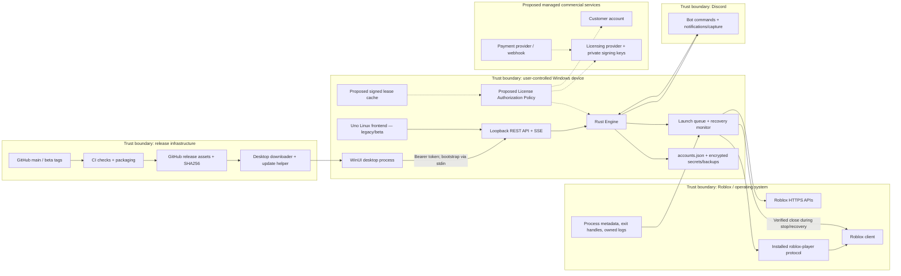

# RoLauncher — Commercial Readiness Audit (Phase 0)

Audit date: October 15, 2026. Repository: `oangsa/RoLauncher`.

Status: **Provisional decisions; legal and architecture approval required.**

**Recommendation: CONDITIONAL GO for commercial development after the legal and policy gates below; NO-GO for selling the current build.**

This audit inspected the repository, GitHub metadata, published artifacts, and official documentation. No application source, licenses, workflows, instructions, or release artifacts were changed during the audit. This report is the only subsequently requested documentation addition; Phase 1 has not started.

## A. Executive summary

The smallest viable approach is to retain the existing Rust supervisor and WinUI frontend, add one authorization policy inside the engine, and use a managed licensing provider. A separate licensing microservice is unnecessary unless the selected provider cannot support the approved policies.

The principal blockers are:

1. Unresolved rights to reuse existing code in a proprietary product.
2. Unresolved Roblox policy exposure, particularly singleton coordination, ticket acquisition, and private-server parsing.
3. Conflicting offline/startup requirements.
4. No commercial authorization boundary, including for automatic recovery.
5. Unsigned published application binaries and installer, with checksum-only update verification.

### Verified baseline

| Item | Verified result |
|---|---|
| Local checkout | `feature/release-1.7.0`, commit `6f3226a`; working tree clean at audit completion |
| GitHub default branch | `main`, commit `4daae1bfc14db1336e1366134367ccb16efb7d4d` |
| Source comparison | Local HEAD and default-branch commit have identical tracked contents |
| Latest published stable | [`v1.7.0`](https://github.com/oangsa/RoLauncher/releases/tag/v1.7.0), published October 15, 2026 |
| Release controls | GitHub reports `immutable: false`; `main` reports `protected: false`; repository ruleset list is empty |
| CI | [Release workflow](https://github.com/oangsa/RoLauncher/actions/runs/38739715691) completed successfully, including Windows and Linux jobs |
| Artifact inspection | Published source ZIP, Windows ZIP, and installer were inspected in memory; hashes matched GitHub asset metadata |
| Signing | Published Rust executable, desktop executable, and installer have empty PE certificate tables—no embedded Authenticode signatures |

Existing CI success is useful baseline evidence. It does not validate a future licensing system, establish legal clearance, or replace live commercial acceptance testing. Test results cited from CI and repository documentation are historical; application tests were not rerun for this read-only audit.

### Published artifact evidence

| Artifact | Bytes | SHA256 |
|---|---:|---|
| `rolauncher-v1.7.0-source.zip` | 4,110,123 | `333dcbe1d1b32b8a833e933cd69fce46a5aec90a44c8547fa2ecc771fb9dd0de` |
| `rolauncher-v1.7.0-setup-x64.exe` | 65,658,398 | `71b5010ef6c7ff0eb4b54ad4421b245c3cef48fcd2c76ccbc35ebb3a6a2e7b14` |
| `rolauncher-v1.7.0-windows-x64.zip` | 94,579,670 | `379d686e74d125fed3819d72f238697d653302f83df078338165b736c51b7013` |

The source ZIP contains 162 entries, including the sampled engine, frontend project, lock files, build script, GPL license, and `AGENTS.md`. These checks establish sampled contents and agreement with GitHub metadata, not complete corresponding-source compliance or independent publisher authenticity.

## B. Verified current architecture

Solid arrows show existing connections. Dotted arrows show proposed commercial integration.

The Linux node represents the alternative Linux deployment, not a process running on Windows.

| Component | Current behavior and evidence |
|---|---|
| Rust supervisor | Initializes storage, coordination, workers, API, and optional UI. Workers start before the UI. [main.rs:70–128](https://github.com/oangsa/RoLauncher/blob/4daae1bfc14db1336e1366134367ccb16efb7d4d/src/main.rs#L70) |
| Windows frontend | Separate process; Rust passes the API token through piped stdin rather than command-line arguments. [desktop.rs:17–48](https://github.com/oangsa/RoLauncher/blob/4daae1bfc14db1336e1366134367ccb16efb7d4d/src/desktop.rs#L17) |
| Linux frontend | Uno shares substantial frontend code with Windows. [Linux project:19–31](https://github.com/oangsa/RoLauncher/blob/4daae1bfc14db1336e1366134367ccb16efb7d4d/desktop.linux/RoLauncher.Linux.csproj#L19) |
| Local API | Loopback binding, bearer authentication, browser-origin rejection, and a 1 MiB body limit. [api.rs:32–71](https://github.com/oangsa/RoLauncher/blob/4daae1bfc14db1336e1366134367ccb16efb7d4d/src/api.rs#L32), [284–319](https://github.com/oangsa/RoLauncher/blob/4daae1bfc14db1336e1366134367ccb16efb7d4d/src/api.rs#L284) |
| Headless execution | Uses the same supervisor and workers, without opening the frontend. [main.rs:114–128](https://github.com/oangsa/RoLauncher/blob/4daae1bfc14db1336e1366134367ccb16efb7d4d/src/main.rs#L114) |
| Launch/recovery | Commands enqueue intent; workers select destinations, obtain tickets, launch, and monitor sessions. [engine.rs:494–818](https://github.com/oangsa/RoLauncher/blob/4daae1bfc14db1336e1366134367ccb16efb7d4d/src/engine.rs#L494) |
| Credentials | Windows uses user-context DPAPI; Linux uses a Secret Service key and authenticated encryption. [platform.rs:267–329](https://github.com/oangsa/RoLauncher/blob/4daae1bfc14db1336e1366134367ccb16efb7d4d/src/platform.rs#L267), [platform_linux.rs:427–464](https://github.com/oangsa/RoLauncher/blob/4daae1bfc14db1336e1366134367ccb16efb7d4d/src/platform_linux.rs#L427) |
| Discord commands | Guild and user allowlists; accepted stop/restart actions call the engine. [discord_bot.rs:110–114](https://github.com/oangsa/RoLauncher/blob/4daae1bfc14db1336e1366134367ccb16efb7d4d/src/discord_bot.rs#L110), [270–302](https://github.com/oangsa/RoLauncher/blob/4daae1bfc14db1336e1366134367ccb16efb7d4d/src/discord_bot.rs#L270) |
| Updates | Rust discovers releases; desktop downloads and verifies SHA256; a helper installs and restarts the supervisor. [updates.rs:152–205](https://github.com/oangsa/RoLauncher/blob/4daae1bfc14db1336e1366134367ccb16efb7d4d/src/updates.rs#L152), [UpdateHandoff.cs:8–43](https://github.com/oangsa/RoLauncher/blob/4daae1bfc14db1336e1366134367ccb16efb7d4d/desktop/UpdateHandoff.cs#L8) |

## C. Risk register

“Confirmed” describes observed behavior. “Design gap” describes work required for commercialization, not a vulnerability in the current free product.

| ID | Severity | Component | Evidence (file/lines) | Risk | Recommendation | Blocking? |
|---|---|---|---|---|---|---|
| R01 | P0 | Code provenance | [THIRD_PARTY_NOTICES.md:3–8](https://github.com/oangsa/RoLauncher/blob/4daae1bfc14db1336e1366134367ccb16efb7d4d/THIRD_PARTY_NOTICES.md#L3) | Unresolved: proprietary reuse rights are not established. | Document ownership and compare referenced implementations; obtain legal clearance or replace affected material. | Before proprietary reuse/distribution |
| R02 | P0 | Roblox integration | [platform.rs:495–555](https://github.com/oangsa/RoLauncher/blob/4daae1bfc14db1336e1366134367ccb16efb7d4d/src/platform.rs#L495); [roblox.rs:171–270](https://github.com/oangsa/RoLauncher/blob/4daae1bfc14db1336e1366134367ccb16efb7d4d/src/roblox.rs#L171) | Review required: singleton coordination and legacy launch mechanisms may implicate platform restrictions. | Obtain feature-specific policy/legal assessment; disable unresolved features in the commercial product if necessary. | Before commercial beta |
| R03 | P0 | Product policy | Owner decisions 4 and 8 | Ambiguous: seven-day offline use and mandatory online startup imply different outage behavior. | Approve the exact meaning of “start,” expiry, restart, and outage behavior. | Before enforcement implementation |
| R04 | P1 | License enforcement | [engine.rs:136–147](https://github.com/oangsa/RoLauncher/blob/4daae1bfc14db1336e1366134367ccb16efb7d4d/src/engine.rs#L136), [597–670](https://github.com/oangsa/RoLauncher/blob/4daae1bfc14db1336e1366134367ccb16efb7d4d/src/engine.rs#L597) | Design gap: persisted intent and workers can launch without any frontend action. | Central engine authorization covering startup, commands, and actual dispatch. | Before paid build |
| R05 | P1 | Recovery continuity | [engine.rs:1015–1037](https://github.com/oangsa/RoLauncher/blob/4daae1bfc14db1336e1366134367ccb16efb7d4d/src/engine.rs#L1015) | Integration hazard: recovery can close a client before replacement authorization is checked. | Authorize automatic recovery before destructive closure; check again before dispatch. | Before licensed recovery |
| R06 | P1 | Publisher authenticity | Published PE inspection; [UpdateDownloader.cs:111–121](https://github.com/oangsa/RoLauncher/blob/4daae1bfc14db1336e1366134367ccb16efb7d4d/desktop/UpdateDownloader.cs#L111) | Confirmed: published executables lack embedded signatures; update verification trusts hashes from the release host. | Authenticode signing plus independently signed update metadata. | Before paid distribution |
| R07 | P1 | Release control | [ci-release.yml:155–176](https://github.com/oangsa/RoLauncher/blob/4daae1bfc14db1336e1366134367ccb16efb7d4d/.github/workflows/ci-release.yml#L155); GitHub branch/release metadata | Confirmed: eligible main runs publish automatically; no workflow approval environment is declared. | Protected promotion, approved signing/publishing environment, protected tags, immutable releases. | Before commercial publishing |
| R08 | P1 | Commercial distribution | [package.ps1:30–38](https://github.com/oangsa/RoLauncher/blob/4daae1bfc14db1336e1366134367ccb16efb7d4d/scripts/package.ps1#L30); [updates.rs:166–174](https://github.com/oangsa/RoLauncher/blob/4daae1bfc14db1336e1366134367ccb16efb7d4d/src/updates.rs#L166) | Confirmed incompatibility: packaging publishes source; updater assumes public GitHub access. | Establish legally cleared commercial packaging and update delivery separately from GPL legacy releases. | Before private distribution |
| R09 | P1 | Device/revocation policy | No current licensing implementation | Design limitation: one server activation does not instantly invalidate an offline lease on another device. | Approve transfer overlap or wait for the old lease to expire. | Before activation implementation |
| R10 | P2 | Resource bounds | [store.rs:39–45](https://github.com/oangsa/RoLauncher/blob/4daae1bfc14db1336e1366134367ccb16efb7d4d/src/store.rs#L39); [roblox.rs:394](https://github.com/oangsa/RoLauncher/blob/4daae1bfc14db1336e1366134367ccb16efb7d4d/src/roblox.rs#L394); [servers.rs:125–133](https://github.com/oangsa/RoLauncher/blob/4daae1bfc14db1336e1366134367ccb16efb7d4d/src/roblox/servers.rs#L125) | Confirmed hardening gaps: ordinary database loading and some upstream response parsing lack explicit byte caps. | Bound reads and validate collection sizes; test oversized responses/files. | Before production hardening completion |
| R11 | P2 | Local API workload | [api.rs:32–71](https://github.com/oangsa/RoLauncher/blob/4daae1bfc14db1336e1366134367ccb16efb7d4d/src/api.rs#L32), [407–426](https://github.com/oangsa/RoLauncher/blob/4daae1bfc14db1336e1366134367ccb16efb7d4d/src/api.rs#L407) | Hardening gap: no application-level request/concurrency/SSE quota is installed here. | Bound expensive authenticated operations and active streams. Exposure is local and token-protected. | Before production hardening completion |
| R12 | P2 | Dependency assurance | [Windows project:19](https://github.com/oangsa/RoLauncher/blob/4daae1bfc14db1336e1366134367ccb16efb7d4d/desktop/RoLauncher.Desktop.csproj#L19); [Linux project:15](https://github.com/oangsa/RoLauncher/blob/4daae1bfc14db1336e1366134367ccb16efb7d4d/desktop.linux/RoLauncher.Linux.csproj#L15) | Confirmed: NuGet vulnerability auditing is disabled; inspected release CI lacks a dedicated dependency-advisory gate. | Add advisory and license-policy checks with reviewed exceptions. No specific vulnerable package is asserted here. | Before paid release |
| R13 | P1 | Compatibility evidence | [VALIDATION.md:90–103](https://github.com/oangsa/RoLauncher/blob/4daae1bfc14db1336e1366134367ccb16efb7d4d/docs/VALIDATION.md#L90) | Confirmed validation gap: complete live multi-account/recovery compatibility remains unestablished. | Run consented Windows acceptance tests before making commercial reliability claims. | Before sale |

## D. Legal and platform compliance

### License and code-provenance matrix

| Material | Confirmed observation | Unresolved issue | Commercial treatment |
|---|---|---|---|
| Project source | Declared GPL-3.0-only. [Cargo.toml:1–6](https://github.com/oangsa/RoLauncher/blob/4daae1bfc14db1336e1366134367ccb16efb7d4d/Cargo.toml#L1) | Who owns every copyrightable contribution? | Preserve GPL history; clear rights before proprietary reuse. |
| Commit history | Reachable local history contains two author identities. | Whether these represent one person; employment, contractor, imported-code, or assignment obligations. | Obtain owner attestation and any necessary contributor permissions. |
| Roblox Account Manager reference | Notices identify upstream revision c2b13d1. | Whether protected expression was adapted, rather than only behavior or protocols. | Focused comparison and counsel review. |
| Rust dependencies | Offline metadata resolved 312 package records, including the root package. Windows artifact metadata contains 211 records. | Metadata is not a complete legal review of embedded/native material. | Record chosen licenses and retain required notices. |
| Alternative-license crates | r-efi offers permissive alternatives alongside LGPL. | Which alternative is selected for distribution. | A GPL/LGPL option in an OR expression is not automatically a copyleft blocker. |
| Windows NuGet/runtime | Published metadata contains 14 NuGet packages and accompanying notices. | Microsoft redistribution terms require review beyond SPDX labels. | Retain notices and verify rights for shipped components. |
| Linux dependencies | Cached LibVLCSharp 3.9.7.1 metadata declares LGPL-2.1-or-later. [lock:253](https://github.com/oangsa/RoLauncher/blob/4daae1bfc14db1336e1366134367ccb16efb7d4d/desktop.linux/packages.lock.json#L253) | Whether it is actually shipped/used; applicable replacement/source obligations. Several Uno packages lack license declarations in cached nuspec metadata. | Keep Linux outside initial commercial scope; complete a payload-specific review before later commercialization. |
| GCC/runtime DLLs | Notices identify applicable GPL/LGPL runtime exceptions. [notices:14](https://github.com/oangsa/RoLauncher/blob/4daae1bfc14db1336e1366134367ccb16efb7d4d/THIRD_PARTY_NOTICES.md#L14) | Exact obligations depend on the shipped toolchain/runtime. | Review actual payload; exceptions matter. |
| Fonts and artwork | Inter is documented under OFL; icon generation provenance is recorded. [font README](https://github.com/oangsa/RoLauncher/blob/4daae1bfc14db1336e1366134367ccb16efb7d4d/assets/fonts/README.md), [icon README](https://github.com/oangsa/RoLauncher/blob/4daae1bfc14db1336e1366134367ccb16efb7d4d/assets/README.md) | Brand clearance and any contractual ownership questions. | Preserve font notices; review commercial branding. |
| Published GPL artifacts | v1.7.0 includes a source archive with sampled required source/build files. | Complete corresponding-source compliance was not legally certified. | Preserve releases, notices, and applicable source availability obligations. |

The sampled upstream comparison found matching protocol elements and private-server parsing targets, with different surrounding implementations. This establishes a review target, not a finding of copying or infringement.

Upstream [Account.cs](https://github.com/ic3w0lf22/Roblox-Account-Manager/blob/c2b13d146d5db609d499870145e8d2dff2506581/RBX%20Alt%20Manager/Classes/Account.cs) contains related ticket, launch-URI, and `joinPrivateGame` logic. RoLauncher implements these in [roblox.rs:171–270](https://github.com/oangsa/RoLauncher/blob/4daae1bfc14db1336e1366134367ccb16efb7d4d/src/roblox.rs#L171) and [466–471](https://github.com/oangsa/RoLauncher/blob/4daae1bfc14db1336e1366134367ccb16efb7d4d/src/roblox.rs#L466).

### Legal conclusions, subject to qualified counsel

- GPL software can be sold. “Commercial” does not itself require proprietary licensing.
- A copyright holder may offer its own code under additional licenses. Git authorship alone does not prove the necessary ownership.
- If third-party GPL-covered expression is incorporated, a Rust rewrite or private repository does not automatically remove its obligations.
- Existing recipients’ GPL rights cannot simply be withdrawn by announcing a proprietary successor.
- Dual licensing is feasible only with sufficient rights. A separate commercial repository is an organizational boundary, not legal clearance.

These principles follow the [GNU licensing FAQ](https://www.gnu.org/licenses/gpl-faq.en.html) and [GPLv3 terms](https://www.gnu.org/licenses/gpl-3.0.html). Counsel should determine the actual application to this codebase, including distribution and corresponding-source obligations.

### Roblox policy assessment

The official PDF inspected is effective May 19, 2026. The live support page advertises another version effective November 1, 2026, so launch review must distinguish current and upcoming terms. The current terms address credential security, documented API access, reverse engineering, and technological protection measures: [current terms](https://en.help.roblox.com/hc/tr/article_attachments/47741686745236), [upcoming terms](https://en.help.roblox.com/hc/en-us/articles/115004647846-Roblox-Terms-of-Use).

| Feature | Technical observation | Required commercial review |
|---|---|---|
| Multi-account storage | Stores and authenticates supplied sessions. | Require ownership/authorization; prohibit account trading and unauthorized account access. |
| Browser sign-in/cookie import | Captures .ROBLOSECURITY locally and imports it into encrypted storage. [login.rs:95–136](https://github.com/oangsa/RoLauncher/blob/4daae1bfc14db1336e1366134367ccb16efb7d4d/src/login.rs#L95) | Explicit credential-handling disclosure; assess approved authentication alternatives. |
| Ticket-based launching | Calls an authentication-ticket endpoint and the installed launch protocol. | The inspected official auth reference does not list that ticket endpoint; obtain clarification. Absence alone does not prove prohibition. [Auth reference](https://create.roblox.com/docs/cloud/reference/domains/auth) |
| Server/presence lookup | Uses endpoints listed in official documentation. | Preserve access controls, rate limits, and API identity. Documentation does not constitute approval of the whole product. [Games](https://create.roblox.com/docs/cloud/reference/domains/games), [Presence](https://create.roblox.com/docs/cloud/reference/domains/presence) |
| Hidden peer presence | Can query a managed peer using that peer’s stored session. [server_selection.rs:73–95](https://github.com/oangsa/RoLauncher/blob/4daae1bfc14db1336e1366134367ccb16efb7d4d/src/engine/server_selection.rs#L73) | Explicit consent and privacy review; do not market it as bypassing privacy controls. |
| Singleton coordination | Acquires ROBLOX_singletonMutex. | High-priority clarification concerning interference/protection-measure restrictions. |
| Process/log inspection | Uses metadata, exit handles, and verified log ownership. No process-memory reading/writing or injection was found in the inspected implementation. | Document exact behavior; repository permission for read-only inspection is not Roblox approval. |
| Stop/recovery | Can send WM_CLOSE, then terminate a verified owned process. | Disclose automatic closure and obtain informed feature consent. |
| Discord/capture | Remote allowlisted controls and optional capture/notifications. | Explicit opt-in, destination disclosure, and least-privilege configuration. |

Roblox warns against modified clients and software that changes or interferes with Roblox. This creates review exposure for particular mechanisms; it does not establish that every external launcher is prohibited. See [official anti-cheat guidance](https://en.help.roblox.com/hc/en-us/articles/24275616578708-Anti-cheat-Messages).

## E. License enforcement coverage matrix

Recommended boundary: one engine-owned policy, checked when accepting protected intent and immediately before protected side effects.

| Entry point | Verified call chain | Proposed authorization boundary | Bypass risk if omitted | Required tests |
|---|---|---|---|---|
| WinUI Start/Restart, row/bulk actions | RunActionAsync → API → Engine::command → queue | Before command mutation; again at dispatch | UI-only checks are bypassed by API callers | Licensed/denied commands; mixed bulk results |
| Native/local API | Account action route → engine | Engine policy after API authentication | Possession of API token becomes sufficient | Valid API token with invalid license must fail |
| Preset Start | launch_profile → apply_profile → command | Before launch-related preset mutation; each dispatch | Preset path can retain launch side effects despite denial | No launch-related partial mutation when globally denied |
| Retry Now | command("retry") → retry_now → launch_loop | Before rescheduling and at dispatch | Retry has its own early branch | Expired/revoked retry cannot queue |
| Saved-session resume | Engine::open → saved desired_running → spawn → launch_loop | Default-denied policy before workers can perform protected operations | Startup can relaunch without user action | Open populated store while unauthorized |
| Headless | main --headless → same workers/API | Same engine policy | Frontend checks never run | Headless startup without online authorization |
| Disconnect recovery | signal → monitor → close → backoff → launch | Before automatic close; again before ticket/launch | Existing client closes but replacement is denied | Expiry/revocation during grace and close preparation |
| Process-exit recovery | monitor → apply_failure → backoff → launch | Scheduling/dispatch policy | Autonomous replacement bypasses command gate | Expiry while awaiting retry |
| Friend/server-selection wait and fallback | launch_one → select_launch_target → ticket → launch_for | Recheck after awaits, before ticket creation and final dispatch | Lease can expire during network work | Expiry/revocation during selection and ticket request |
| Discord Restart | authorized interaction → bot_command → command_inner | Existing bot checks and license policy | Bot bypasses frontend | Authorized Discord user with invalid license |
| Update/crash relaunch | New supervisor → saved state → workers | Approved startup policy | Cached state accidentally authorizes a new process | Outage during update restart; crash restart |
| Restore/diagnostics/Stop | Recovery and management paths | Separate maintenance permissions | Lockout can prevent safe recovery; restore could resurrect entitlement state | Stop/export/recovery available; restore never restores license authority |

Relevant traces include [WinUI actions:427–445](https://github.com/oangsa/RoLauncher/blob/4daae1bfc14db1336e1366134367ccb16efb7d4d/desktop/MainWindow.xaml.cs#L427), [engine commands:494–542](https://github.com/oangsa/RoLauncher/blob/4daae1bfc14db1336e1366134367ccb16efb7d4d/src/engine.rs#L494), [retry:207–219](https://github.com/oangsa/RoLauncher/blob/4daae1bfc14db1336e1366134367ccb16efb7d4d/src/engine/management.rs#L207), and [preset launch:351–367](https://github.com/oangsa/RoLauncher/blob/4daae1bfc14db1336e1366134367ccb16efb7d4d/src/engine/management.rs#L351).

### Implementation constraints

- The existing launch_allowed flag represents OS coordination, not licensing. Keep these conditions separate; the coordination worker writes that flag. [platform.rs:535–551](https://github.com/oangsa/RoLauncher/blob/4daae1bfc14db1336e1366134367ccb16efb7d4d/src/platform.rs#L535)
- Recheck authorization after asynchronous work and inside the final serialized dispatch boundary at [engine.rs:781–806](https://github.com/oangsa/RoLauncher/blob/4daae1bfc14db1336e1366134367ccb16efb7d4d/src/engine.rs#L781).
- Do not hold the engine mutex during licensing network calls.
- Denial should pause new launches/recovery without setting state that causes the monitor to close an otherwise running client.
- Stop, credential removal, backup/export, and diagnostics should remain available under the approved maintenance policy.
- trace_ticket directly prepares a ticket outside the engine; it does not launch a client. Exclude developer tooling from commercial execution paths or route protected ticket preparation through the policy. [example](https://github.com/oangsa/RoLauncher/blob/4daae1bfc14db1336e1366134367ccb16efb7d4d/examples/trace_ticket.rs#L1)

## F. Proposed commercial architecture

### Provisional owner decisions

| Decision | Design consequence |
|---|---|
| 1. One-time / lifetime | Perpetual purchase entitlement; renewable authorization leases. Lifetime updates/support still need definition. |
| 2. GPL legacy + commercial future | Preserve legacy releases; proprietary reuse depends on rights clearance. |
| 3. One device (1 เครื่อง) | One authoritative activation allocation, with an explicit transfer policy. |
| 4. Seven days offline (7 วัน) | Maximum lease lifetime of 168 hours from verified issuance/refresh. |
| 5. Windows first | Commercial acceptance and support initially target Windows x64. |
| 6. Managed licensing provider | Provider owns licensing records and signing operations. |
| 7. Account + license key | Account authenticates the purchaser; key claims a license once and links it to that account. |
| 8. Online required to start (ต้องตรวจออนไลน์เพื่อเริ่มใช้งาน) | Requires a precise startup rule before implementation. |

### Resolve the startup conflict explicitly

The most faithful provisional interpretation of decision 8 is below. Every behavior in this table requires owner approval.

| Situation | Proposed behavior |
|---|---|
| Cold start | Require a fresh successful online authorization before enabling protected work |
| Running supervisor loses licensing connectivity | Continue eligible local operations until the signed lease expires |
| Existing lease, but application restarts during outage | Protected operation remains blocked |
| Lease expires | Pause new launch/recovery; retain existing Roblox sessions and maintenance access |
| Server explicitly reports revoked/suspended | Deny protected work; do not treat this as a network outage |
| Roblox itself is unreachable | License grace cannot make Roblox launching available |

Under this interpretation, seven days offline means up to seven days of in-session outage grace, not seven days of offline application starts. If offline cold starts are intended, decision 8 must change.

Checking online for every Roblox Start/rejoin would conflict with the original requirement to avoid licensing requests per local operation.

### Managed implementation options

| Option | Benefits | Limitations | Recommendation |
|---|---|---|---|
| Direct managed licensing and customer identity | Fewest components; provider handles activation, leases, and administration | Must support account binding, fresh startup validation, expiry, revocation, and required signatures | Preferred if a provider proof satisfies every requirement |
| Small broker plus managed licensing provider | Can enforce custom purchase/account/startup policy and hide privileged APIs | Adds an outage dependency, webhook state, monitoring, and possibly signing responsibility | Use only for demonstrated provider gaps |

Keygen is a plausible evaluation candidate. Its documentation describes Ed25519-verifiable offline files, and its feature list includes perpetual licenses, identities, device activation, and node locking. This is a candidate assessment, not completed vendor selection: [cryptography documentation](https://keygen.sh/docs/api/cryptography/), [features/pricing](https://keygen.sh/pricing/).

### Backend comparison

Costs below are service floors, excluding payment fees, signing, email, support, and engineering time.

| Dimension | Cloudflare Workers + D1 | Supabase-based licensing | Managed licensing provider |
|---|---|---|---|
| Monthly cost | Workers paid baseline about US$5, plus usage | Pro starts US$25, with first project included | Provider/tier dependent; Keygen paid amount was not verifiable from the rendered pricing slider |
| Activation consistency | Implement atomic database allocation; never use eventual cache state as seat authority | Implement transactional allocation and constraints | Require provider-guaranteed allocation semantics and concurrency tests |
| Signing/key management | Own issuer and protected key access | Own issuer and protected key access | Prefer provider-held issuer keys |
| Webhooks | Own verification, deduplication, retries, reconciliation | Same, using transactional Postgres | Native integration where sufficient; otherwise a small bridge |
| Availability | Application correctness remains yours | Application correctness remains yours | Less application ownership; service/SLA depends on plan |
| Monitoring/rate limits | Configure and operate | Configure and operate | Provider tools plus startup/refresh/payment monitoring |
| Backup/DR | Own export and restore drills | Managed backups plus independent exports/drills | Contractually verify export, recovery, and vendor-exit capabilities |
| Operational complexity | Highest licensing implementation burden | Moderate infrastructure, substantial licensing burden | Lowest when requirements fit |
| Lock-in | Workers/D1 APIs | More portable data model | Provider protocol, identity, and signing-key dependence |

Pricing sources: [Cloudflare](https://developers.cloudflare.com/workers/platform/pricing/), [Supabase](https://supabase.com/pricing), [Keygen](https://keygen.sh/pricing/). Keygen lists a limited free development tier, but production cost must be confirmed against active-user/request volume and required features.

### Lease and authorization design

Use the provider’s documented signature format and a maintained verifier. Pin the expected algorithm and trusted issuer keys; reject unknown algorithms and keys.

The signed authorization must cover, directly or through verified provider claims:

- Product, license, purchaser/account, activation, and device identity.
- Issued time, expiry, policy/schema version, and permitted features.
- Update entitlement where updates are restricted.
- Lease identity/sequence sufficient for the approved replay policy.

A fresh online startup result must be bound to the authenticated request/session, using a provider-supported freshness mechanism. Do not accept a replayed cached response as evidence of a new online check.

Store licensing credentials with DPAPI, separately from Roblox sessions. A server-held private signing key, provider administration token, or payment secret must never enter the client or untrusted CI jobs.

Refresh asynchronously—for example, every six hours with jitter and bounded backoff—rather than on each launch. Refresh failure must not extend the original expiry.

### Security limits

| Protection | What it establishes | What it cannot guarantee |
|---|---|---|
| Signed lease | Authentic, unmodified issuer claims | That a patched client will enforce them |
| Device-bound activation | Server allocation and device possession checks | Perfect resistance to cloning on user-controlled hardware |
| DPAPI | Protection at rest against other security contexts | Protection from all code running as the same user |
| Offline expiry | Expiry enforcement by an honest client | Immediate offline revocation or tamper-proof time |
| Server activation cap | One allocated activation | Immediate cancellation of a previously issued offline lease |

Use server-time anchoring, monotonic elapsed time during execution, persisted high-water state, and fail-closed handling of suspicious clock rollback. These reduce accidental abuse; they do not make local clocks or snapshots cryptographically trustworthy.

For strict one-device operation, transferring a license may require waiting until the old lease expires. Immediate transfer with offline grace necessarily permits some overlap unless the old device reliably checks in.

Never send Roblox cookies, tickets, authenticated launch URLs, account databases, or raw logs to the licensing backend.

### Input validation and application security

Existing strengths include bounded API bodies/import counts, cookie validation, redirect restrictions, encrypted backups, bounded update downloads, and diagnostic allowlists. Evidence: [api.rs:69](https://github.com/oangsa/RoLauncher/blob/4daae1bfc14db1336e1366134367ccb16efb7d4d/src/api.rs#L69), [345–358](https://github.com/oangsa/RoLauncher/blob/4daae1bfc14db1336e1366134367ccb16efb7d4d/src/api.rs#L345), [roblox.rs:452–463](https://github.com/oangsa/RoLauncher/blob/4daae1bfc14db1336e1366134367ccb16efb7d4d/src/roblox.rs#L452), [management.rs:413–419](https://github.com/oangsa/RoLauncher/blob/4daae1bfc14db1336e1366134367ccb16efb7d4d/src/engine/management.rs#L413).

Future licensing boundaries need bounded parsing before allocation, strict claim validation, activation idempotency, atomic seat allocation, rate limits, and redacted error codes. Payment webhooks need signature verification, replay protection, durable deduplication, and reconciliation for duplicate/out-of-order events.

## G. Release, deployment, and rollback plan

1. Freeze the GPL baseline. Preserve published releases, source, notices, and artifact hashes. Do not overwrite the locally present stable-named artifacts with GitHub’s differing builds.
2. Clear commercial rights and scope. Approve the provenance assessment, allowed Roblox mechanisms, EULA, privacy terms, lifetime definition, and outage/device policies.
3. Introduce protected release promotion. Require reviewed changes, required CI checks, protected tags, and an approval-gated signing/publishing environment. Pin third-party Actions to reviewed commit hashes.
4. Build and test consistently. Retain existing Rust, desktop, UI, installer, package, and Linux legacy checks. Add the licensing contract tests in section H.
5. Sign before hashing. Sign project executables, then build/sign the installer; timestamp signatures. Compute final artifact hashes afterward.
6. Sign update metadata. Include product, channel, platform, version, artifact hash/size, schema compatibility, expiry, and monotonic metadata version. Use update keys separate from licensing keys.
7. Stage, canary, beta, stable. Keep entitlement state and provider environments separate. Canary requires a new explicit channel; current discovery only implements stable and optional beta.
8. Promote identical bytes. Test and promote the same verified artifacts; enable release immutability for future releases. Never replace published assets.
9. Monitor rollout. Track activation conflicts, online-start success, refresh failures, webhook lag, update verification failures, and migration errors without collecting Roblox secrets.

Current publishing protects published assets in the script and uploads through a draft. It then automatically publishes that draft; a draft is not a human approval gate. [publish-release.py:43–76](https://github.com/oangsa/RoLauncher/blob/4daae1bfc14db1336e1366134367ccb16efb7d4d/scripts/publish-release.py#L43)

### Versioning and package continuity

- Follow `AGENTS.md`; do not select a release version during Phase 0.
- Reverify the latest published stable before preparing any future release target.
- Use fresh development identities for local builds; use plain stable versions only for intentionally approved GitHub releases.
- Preserve corresponding-source and notice obligations for GPL distributions, including `AGENTS.md`, lock files, and build inputs.
- Keep Windows packages complete with WebView2Loader.dll, runtime/license notices, and final SHA256 checksums.
- Commercial packaging changes require the approved legal disposition; do not silently remove required source.

### Private commercial updates

The updater makes unauthenticated GitHub requests and permits automatic installation only from the official public release URL pattern. A private commercial repository is therefore not a drop-in replacement. [updates.rs:166–174](https://github.com/oangsa/RoLauncher/blob/4daae1bfc14db1336e1366134367ccb16efb7d4d/src/updates.rs#L166), [UpdateDownloader.cs:28–42](https://github.com/oangsa/RoLauncher/blob/4daae1bfc14db1336e1366134367ccb16efb7d4d/desktop/UpdateDownloader.cs#L28)

Choose either public signed commercial binaries with runtime licensing, or entitlement-controlled downloads through a provider/service. Never embed a GitHub repository token in the application.

### Rollback and migrations

- Prefer a new, higher-version corrective release containing reverted behavior. The installer blocks downgrades. [installer:62–71](https://github.com/oangsa/RoLauncher/blob/4daae1bfc14db1336e1366134367ccb16efb7d4d/installer/RoLauncher.iss#L62)
- Before schema changes, preserve a verified backup and use transactional migration.
- Keep license/activation state outside account backups; restoring user data must not restore entitlement authority.
- Use additive backend changes and versioned contracts before removing old fields.
- Reject unsupported client/schema versions with actionable errors; retain Stop and data-recovery access.
- Reconcile payments and activations after backend restoration before issuing new leases.
- Test interrupted installation, disk-full conditions, incompatible data, and failed restart.

The Windows helper preserves Roblox processes and waits for launcher shutdown, but does not provide a verified full application rollback. [apply-update.ps1:50–78](https://github.com/oangsa/RoLauncher/blob/4daae1bfc14db1336e1366134367ccb16efb7d4d/scripts/apply-update.ps1#L50)

Linux stages a directory replacement with limited exception recovery; successful process spawning is not a health check. [Linux updater:63–95](https://github.com/oangsa/RoLauncher/blob/4daae1bfc14db1336e1366134367ccb16efb7d4d/scripts/apply-update-linux.py#L63)

With mandatory online cold starts, an update or crash during a licensing outage can leave supervision unavailable. Defer elective updates during outages; zero-downtime restart cannot be promised under that policy.

## H. Prioritized implementation backlog

All tasks below are proposals. Implementation requires explicit Phase 1 approval.

| Task | Priority / dependencies | Acceptance criteria |
|---|---|---|
| T01 Ownership/provenance dossier | P0 | All commercial reused files have ownership/provenance disposition; counsel resolves RAM reference areas. |
| T02 Roblox mechanism review | P0 | Approved feature list identifies permitted, disabled, and externally unresolved mechanisms. |
| T03 Policy ADR | P0 | Startup, seven-day expiry, transfers, revocation, lifetime, and maintenance access have deterministic rules. |
| T04 Provider proof | P1; T03 | Sandbox demonstrates account/key binding, atomic one-seat activation, signed expiry, revocation, export, and required freshness. |
| T05 Authorization policy tests | P1; T03 | Fake clock/provider tests cover malformed signatures, wrong issuer/device/product, expiry, rollback, and explicit revocation. |
| T06 Engine integration | P1; T05 | Every section E path denies unauthorized side effects; expiry during awaits cannot dispatch a launch. |
| T07 Recovery continuity | P1; T06 | Denial before automatic close preserves running clients; Stop remains functional. |
| T08 Activation lifecycle | P1; T04 | Concurrent activations allocate one seat; retries are idempotent; transfers obey the approved overlap rule. |
| T09 Secure cache/refresh | P1; T04–T06 | Atomic DPAPI storage; restart/outage policy enforced; retries never extend expiry; secrets absent from diagnostics. |
| T10 Payment lifecycle | P1; T03–T04 | Duplicate, delayed, and reversed payment events produce correct auditable entitlement state. |
| T11 Signing/update trust | P1 | Tampered, expired, replayed, wrong-channel, and wrong-publisher artifacts fail before installation. |
| T12 Commercial release pipeline | P1; T01, T11 | Approved immutable promotion; complete notices/SBOM; commercial source packaging follows counsel-approved rights. |
| T13 Resource/advisory hardening | P2 | Oversized files/responses and request floods remain bounded; dependency findings require disposition. |
| T14 Migration/restore drills | P1; T06–T12 | Interrupted upgrades recover; backups cannot resurrect a license; old-client compatibility is tested. |
| T15 Windows acceptance | P1; T02, T06–T14 | Consented live multi-account, disconnect/rejoin, Discord, outage, activation, and update tests pass. |

For Phase 1, write failing policy and integration tests first, then add the smallest implementation that satisfies them. Reuse existing engine, API, and installer fixtures.

## I. Owner decision register

The eight owner choices remain provisional. The following details still require approval.

| ID | Question | Options | Recommended default | Consequences | Required before phase |
|---|---|---|---|---|---|
| D01 | What exactly does start mean? | Application startup; first protected use; each Roblox launch | Fresh online authorization per supervisor process; lease thereafter | Offline cold starts remain blocked | Enforcement |
| D02 | Does seven-day grace survive restart? | Yes; no | No, if decision 8 remains strict | Crash/update during outage interrupts supervision | Enforcement |
| D03 | What does lifetime include? | Purchased version; all future versions; service/support lifetime | Publish separate use, update, support, and service commitments | Determines ongoing liability and funding | Checkout/product terms |
| D04 | Is proprietary reuse legally cleared? | Full clearance; permitted subset; independent replacement | Counsel-approved reuse inventory | May change implementation scope substantially | Proprietary reuse |
| D05 | How does device transfer work? | Immediate with overlap; wait for old expiry; verified release | Wait for old lease expiry when strict single-device validity is required | Up to seven-day transfer delay | Activation |
| D06 | What constitutes a device? | Installation key; hardware fingerprint; hardware-backed key | Stable device key with documented replacement rules | Reinstall/hardware changes affect support | Activation |
| D07 | What happens on expiry/revocation? | Pause new work; terminate sessions | Pause launches/recovery, retain sessions and maintenance access | Revocation does not forcibly end Roblox play | Engine integration |
| D08 | Which provider and plan? | Qualified managed providers | Select through T04 proof | Pricing, SLA, export, and key portability differ | Integration |
| D09 | Which payment/Merchant-of-Record model? | Processor; Merchant of Record | Select after seller-country/tax eligibility review | Tax, refunds, disputes, and fees | Payments |
| D10 | Refund/chargeback policy? | Immediate suspension; reviewed suspension; delayed action | Suspend new authorization with documented appeal/reconciliation | Offline leases retain their approved limits | Payments |
| D11 | Public or private installers? | Public signed binaries; authenticated download | Public signed binaries unless private delivery has a concrete need | Runtime licensing remains necessary | Updater |
| D12 | Which Roblox mechanisms ship? | Cleared set; limited mode; defer product | Only reviewed mechanisms | May reduce multi-instance/private-server features | Commercial beta |
| D13 | GPL legacy maintenance? | Security-only; defined support period; archival | Clearly bounded maintenance promise | Requires separation from commercial entitlement changes | Product announcement |
| D14 | Provider shutdown/end of life? | Vendor migration; sunset authorization; service termination | Fund a documented migration/sunset process | Central to credibility of lifetime | Sale |
| D15 | Customer data policy? | Minimal identifiers; expanded telemetry | Minimal identity/device/payment data; separate opt-in diagnostics | Privacy, retention, deletion, and cross-border obligations | Beta |

Qualified legal review is required for proprietary rights, consumer/lifetime terms, privacy, tax, and platform-policy interpretation. None is approved merely by selecting a technical design.

## J. Proposed ADRs

Write these after the relevant decisions are approved:

1. GPL legacy preservation and commercial code rights.
2. Windows commercial scope and approved Roblox integrations.
3. Lifetime entitlement, updates, support, and end of life.
4. Online startup and seven-day outage semantics.
5. Managed provider, customer identity, and key claiming.
6. Device identity, one-seat allocation, transfers, and revocation.
7. Central engine authorization and recovery continuity.
8. Lease format, trusted keys, refresh, clock handling, and replay limits.
9. Signed updates, release channels, promotion, and rollback.
10. Payment events, reconciliation, privacy, and disaster recovery.

## Required closeout

### Five most important risks

1. Proprietary reuse rights remain unestablished.
2. Specific Roblox mechanisms need policy clearance.
3. Online startup and seven-day offline behavior remain ambiguous.
4. Background recovery needs authorization before closing and replacing clients.
5. Published binaries lack embedded signatures, and updates lack independent publisher verification.

### First five recommended actions

1. Complete the ownership/provenance dossier and obtain counsel’s disposition.
2. Review singleton coordination, ticket launching, private parsing, and peer-session presence.
3. Approve startup/outage, lifetime, transfer, and revocation semantics.
4. Qualify a managed provider with a small sandbox proof.
5. Approve the engine authorization and signing/publishing test plan.

### Decisions before implementation

D01–D08 establish the core architecture; D04 controls proprietary reuse. Payment, distribution, support, privacy, and end-of-life decisions must be settled before their respective implementation or sale gates.

### Verdict

**CONDITIONAL GO for a gated Phase 1; NO-GO for commercial release.** The largest blocker is unresolved proprietary reuse rights. Phase 1 remains unstarted pending explicit owner approval.
